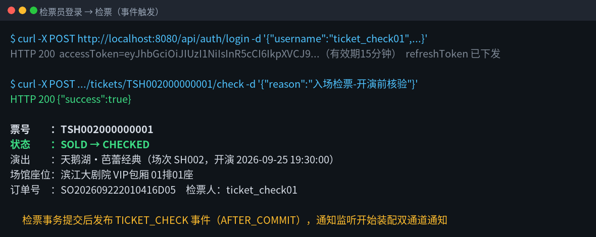
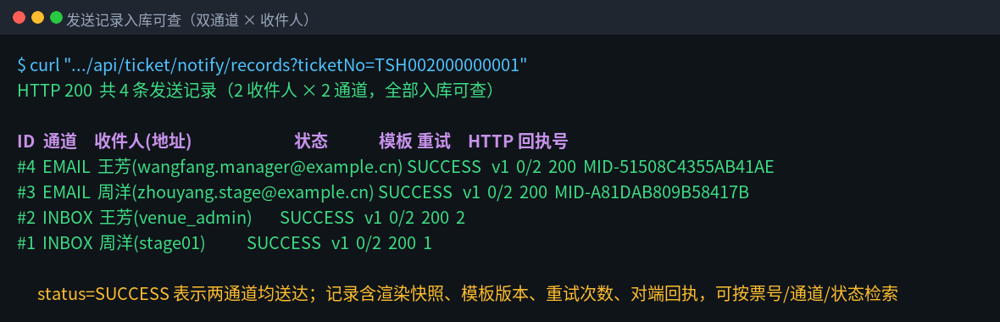
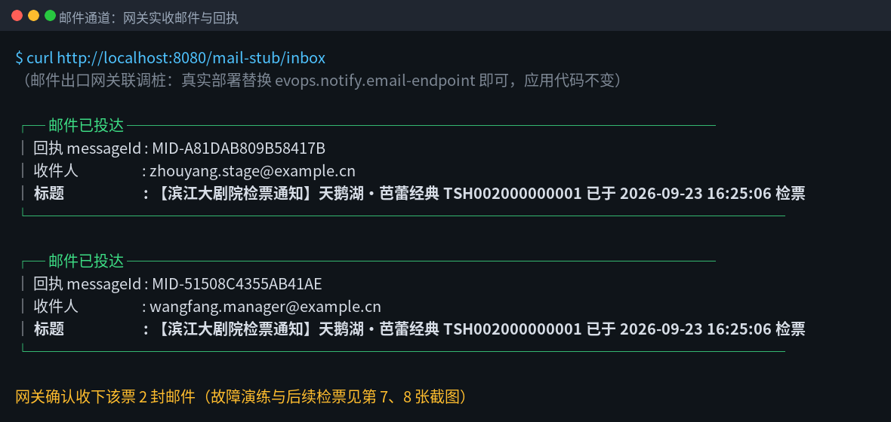
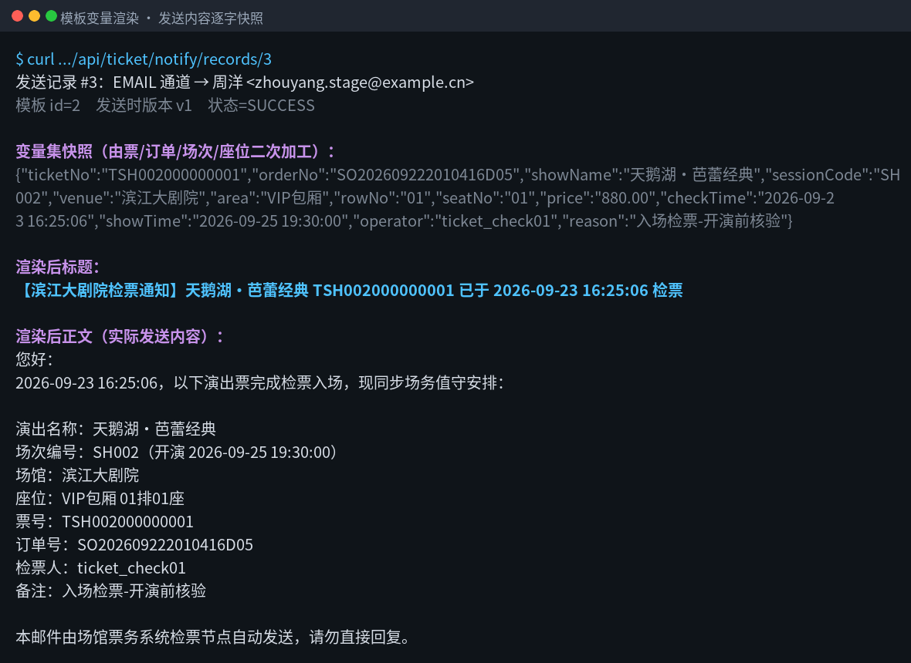
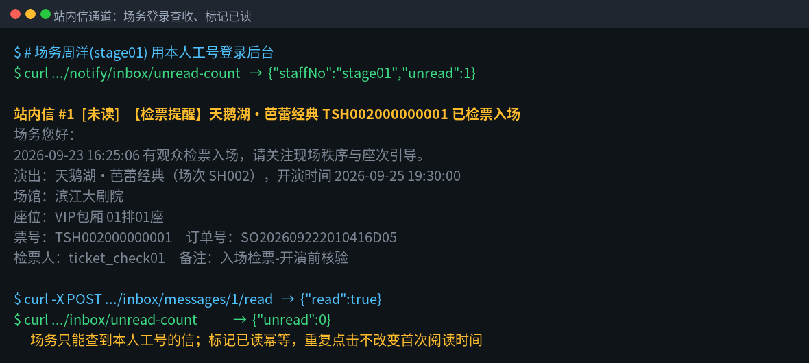
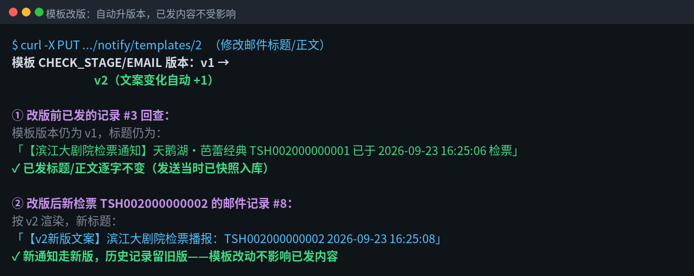
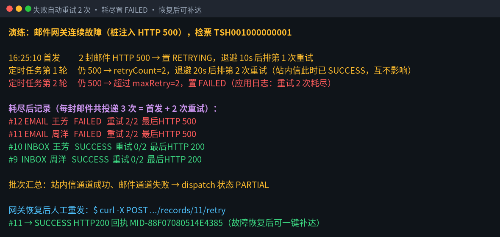
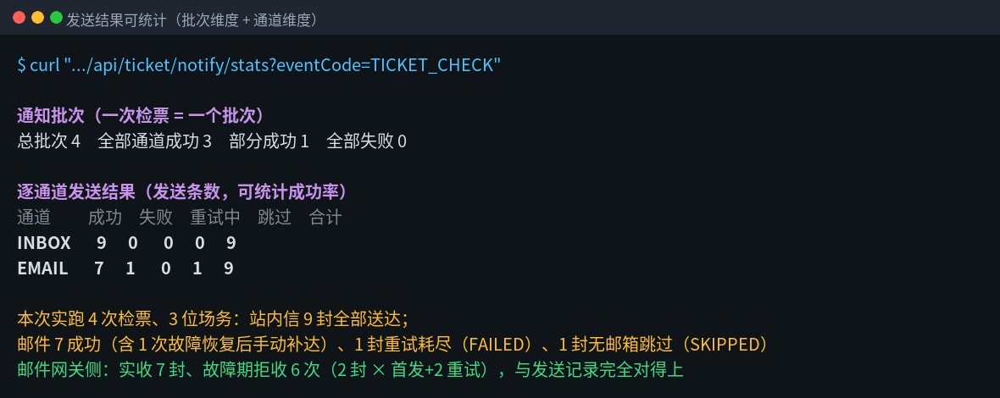

# 检票关键节点通知场务 · 验收报告

- 验收日期：2026-09-23
- 验收环境：本机 `evops-base 0.1.0`（Spring Boot 2.7 + H2 + Flyway 全新建库 V1→V4），样例数据自动播种
- 验收方式：真实启动系统、真实登录、真实检票、真实 HTTP 投递到邮件网关桩；下列截图均来自系统真实返回，未使用单元测试替身
- 参与账号：检票员 `ticket_check01`（赵敏）、场务 `stage01`（周洋，本次新增）、值班经理 `venue_admin`（王芳）
- 演示票：天鹅湖·芭蕾经典（SH002）、山河令·民乐音乐会（SH001）样例票

---

## 一、这次做了什么（一句话版）

观众一检票，系统就**自动**把"什么演出、什么座位、几点几分、谁检的票"通过**站内信和邮件两个通道**发给当班场务；
每条发送都有**记录可查、有成功失败统计**；发邮件遇到故障会**自动重试 2 次**；
通知文案由模板加变量自动生成，**以后改模板不会改动已经发出的内容**。

## 二、验收项与结论总表

| # | 需求 | 结论 | 证据截图 |
|---|---|---|---|
| 1 | 数据二次加工：票/订单/场次/座位汇成现场能用的文案变量 | ✅ 通过 | 截图 4 |
| 2 | 检票关键节点按**事件触发**（检票事务提交后才发，回滚不发） | ✅ 通过 | 截图 1 |
| 3 | 模板变量渲染（`${票号}`、`${座位}` 等占位自动替换） | ✅ 通过 | 截图 4 |
| 4 | **站内信 + 邮件双通道**同时通知 | ✅ 通过 | 截图 2、3、5 |
| 5 | **发送记录入库可查**（按票号/通道/状态检索，含原文） | ✅ 通过 | 截图 2、4 |
| 6 | 失败**自动重试 2 次**，耗尽置失败、可人工补达 | ✅ 通过 | 截图 7 |
| 7 | **模板改动不影响已发内容**（发送当时快照，改后自动升版本） | ✅ 通过 | 截图 6 |
| 8 | **发送结果可统计**（批次维度 + 通道维度） | ✅ 通过 | 截图 8 |
| 9 | 自动化测试（含上述全部关键点）全部通过 | ✅ 40/40 | 见第六节 |

---

## 三、分步验收记录（含截图）

### 步骤 1：检票员登录，对一张票执行检票

检票员用账号登录拿到访问令牌，对天鹅湖 VIP 票 `TSH002000000001` 执行检票。
票状态 `SOLD → CHECKED` 落库、检票事务提交后，系统发布检票事件，通知自动开始——**检票操作本身没有任何额外动作**。



### 步骤 2：一次检票，自动产生双通道发送记录，全部入库

系统按"2 位当班人员 × 2 个通道"生成 4 条发送记录：
- 周洋（场务）：站内信、邮件
- 王芳（值班经理）：站内信、邮件

每条记录都有：通道、收件人、发送状态、所用模板版本、重试次数、对端 HTTP 状态与回执号，可按票号/通道/状态随时检索回查。



### 步骤 3：邮件通道——邮件出口网关真实收下邮件并回回执

邮件经 HTTP 投到企业邮件出口网关（验收环境用内置网关桩，**真实部署只改一个配置地址，代码不动**）。
网关对两封邮件都返回 `code=OK` 和邮件回执号（MID-…），与步骤 2 发送记录里的回执号一一对应。



### 步骤 4：模板变量渲染，发送内容逐字快照留档

系统把分散在票、订单、场次、座位四张表里的字段**二次加工**成一组变量（票号、订单号、演出名、场馆、区域、排座、票价、检票时间、开演时间、检票人、备注），
再填入模板 `${...}` 占位，生成最终标题与正文。
**渲染后的标题、正文、变量集在发送当时就逐字存进发送记录**——这是"改模板不影响已发内容"的基础。



### 步骤 5：站内信通道——场务登录后台即可查收、标记已读

场务周洋用工号 `stage01` 登录，看到未读角标 = 1，信箱里就是刚才那张票的检票提醒，内容与邮件一致但更简短。
点击标记已读后未读数归零；场务只能看到**本人工号**的通知。



### 步骤 6：现场改通知文案——自动升版本，已发内容原样不变

值班经理调整邮件模板文案（标题、正文），保存后模板版本 **v1 自动升到 v2**。
- 改版前已发出的记录 #3：回查仍是 **v1、旧标题旧正文，一字未变**；
- 改版后再检票的新票：按 **v2** 渲染新文案。

历史通知可追溯、未来通知用新版，两不相误。



### 步骤 7：邮件网关故障——自动重试 2 次，耗尽标失败，恢复后一键补达

在网关侧注入连续故障（返回 HTTP 500）后再检票一张：

1. 首发：2 封邮件被网关拒收 → 记录置"重试中"，10 秒后自动第 1 次重试；
2. 定时任务第 1 轮：仍失败 → 20 秒后排第 2 次重试（**此时站内信早已送达，两通道互不拖累**）；
3. 定时任务第 2 轮：仍失败 → 达到上限 **重试 2 次**，记录置 `FAILED`（每封邮件合计投递 3 次）；
4. 该批次站内信成、邮件败，自动汇总是"**部分成功 PARTIAL**"，在统计里一眼可见；
5. 网关恢复后，运维点一次"手动重发"，#11 立即补达成功并拿到新回执号。



### 步骤 8：发送结果可统计

管理端统计接口给出两层数字：
- **批次维度**（一次检票算一批）：全部通道成功 / 部分成功 / 全部失败各多少；
- **通道维度**：站内信、邮件各自的成功、失败、重试中、跳过、合计条数。

本次实跑 4 次检票：站内信 9 封全部送达；邮件 7 封成功（含 1 封故障后补达）、1 封重试耗尽失败、1 封因临时场务无邮箱被跳过（记录为 SKIPPED，不算故障）。
邮件网关侧实收 7 封、故障期拒收 6 次（2 封 × 3 次投递），与系统记录**完全对得上**。



---

## 四、验收中覆盖的边界情况

| 情况 | 系统行为 | 结果 |
|---|---|---|
| 邮件网关持续故障 | 退避重试 2 次后 FAILED，不阻塞检票主流程 | 正常（截图 7） |
| 网关恢复 | 手动一键重发，立即补达 | 正常（截图 7） |
| 临时场务只有工号没开邮箱 | 站内信照发，邮件记 SKIPPED 并写明原因 | 正常（截图 8 口径） |
| 同一检票事件被重复投递 | 批次唯一约束拦截，不重复通知 | 自动化测试覆盖 |
| 检票事务回滚 | AFTER_COMMIT 事件不触发，不发通知 | 沿用既有事件机制 |
| 事后修改模板 | 历史发送内容不变，新版本只影响后续发送 | 正常（截图 6） |

## 五、数据与接口落地一览

- 新增 5 张表（Flyway **V4** 迁移，全新库一键建到最新，旧库增量升级；启动台账对账通过）：
  `t_notify_template`（模板，版本列 `tpl_version`）、`t_notify_recipient`（收件人）、
  `t_notify_dispatch`（通知批次）、`t_notify_record`（逐通道发送记录）、`t_inbox_message`（站内信箱）。
- 主要接口（均需登录令牌）：
  - 检票：`POST /api/ticket/tickets/{票号}/check`（**接口无变化**，通知由事件自动带出）
  - 场务信箱：`GET /api/ticket/notify/inbox/messages`、`/inbox/unread-count`、`POST /inbox/messages/{id}/read`
  - 管理端：模板/收件人维护、`GET /api/ticket/notify/records`（记录查询）、`POST /records/{id}/retry`（手动重发）、`GET /api/ticket/notify/stats`（统计）
- 关键配置（`evops.notify.*`，均可用环境变量覆盖）：总开关与两通道独立开关、邮件网关地址、重试次数（默认 **2**）、退避参数、批量大小。
- 上述截图的原始接口返回（JSON）归档在 [`evidence/`](evidence/) 目录，可逐字段核对；其中 JWT 已脱敏。
- 生产部署注意：演示环境邮件走内置网关桩 `/mail-stub`；上线时把 `EVOPS_NOTIFY_EMAIL_ENDPOINT` 指向企业邮件出口网关即可；如确认无其他用途，可在生产环境移除该桩控制器。

## 六、自动化测试结果
```
mvn test
Tests run: 40, Failures: 0, Errors: 0, Skipped: 0
BUILD SUCCESS
```

其中新增 `CheckinNotifyIntegrationTest`（5 个用例）覆盖：双通道成功与变量渲染、改模板不影响已发、
故障重试 2 次耗尽置 FAILED 且批次 PARTIAL、事件重复触发幂等、无邮箱收件人 SKIPPED；
`FlywayMigrationTest` 已扩展验证 V4 新表/索引与台账双写。

## 七、复现方式（值班/运维可照做）

```bash
# 1. 打包启动（首次自动建表 V1→V4、播种场务账号/收件人/模板）
mvn package -DskipTests
java -jar target/evops-base-0.1.0-SNAPSHOT.jar

# 2. 登录（检票员 / 场务，初始口令 Venue@2026）
curl -X POST http://localhost:8080/api/auth/login -H 'Content-Type: application/json' \
  -d '{"username":"ticket_check01","password":"Venue@2026"}'

# 3. 检票（通知自动发出）
curl -X POST http://localhost:8080/api/ticket/tickets/TSH002000000001/check \
  -H "Authorization: Bearer <accessToken>" -H 'Content-Type: application/json' \
  -d '{"reason":"入场检票"}'

# 4. 查发送记录 / 统计
curl -H "Authorization: Bearer <accessToken>" \
  "http://localhost:8080/api/ticket/notify/records?ticketNo=TSH002000000001"
curl -H "Authorization: Bearer <accessToken>" \
  "http://localhost:8080/api/ticket/notify/stats?eventCode=TICKET_CHECK"

# 5. 故障演练：让邮件网关拒收 6 次（2 人 × 首发+2 重试），再检票观察自动重试
curl -X POST "http://localhost:8080/mail-stub/_admin/fail-mode?times=6&status=500"
```
