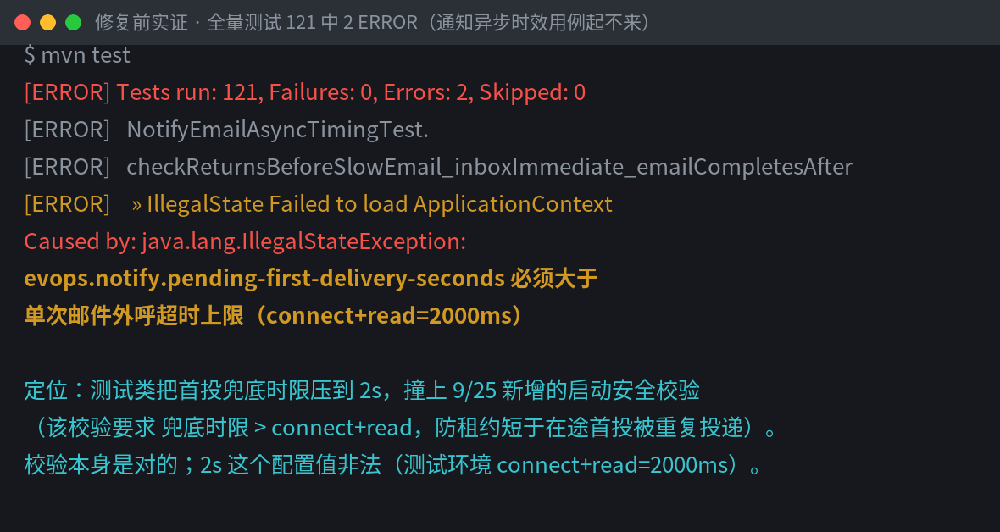
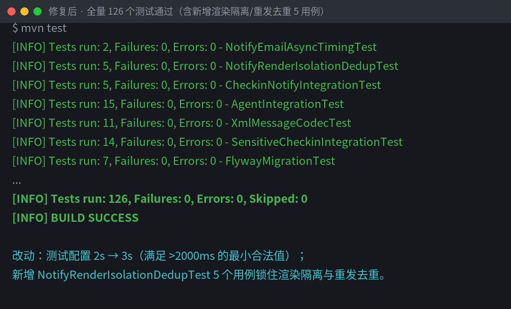
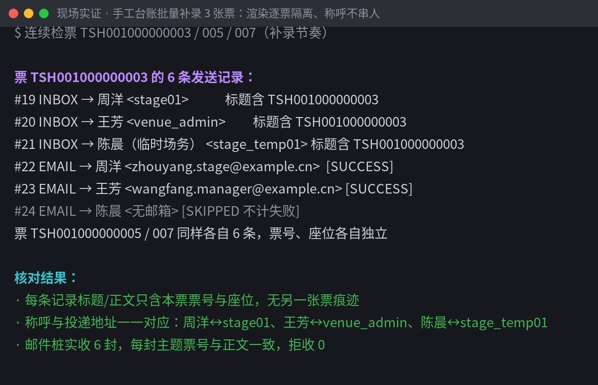
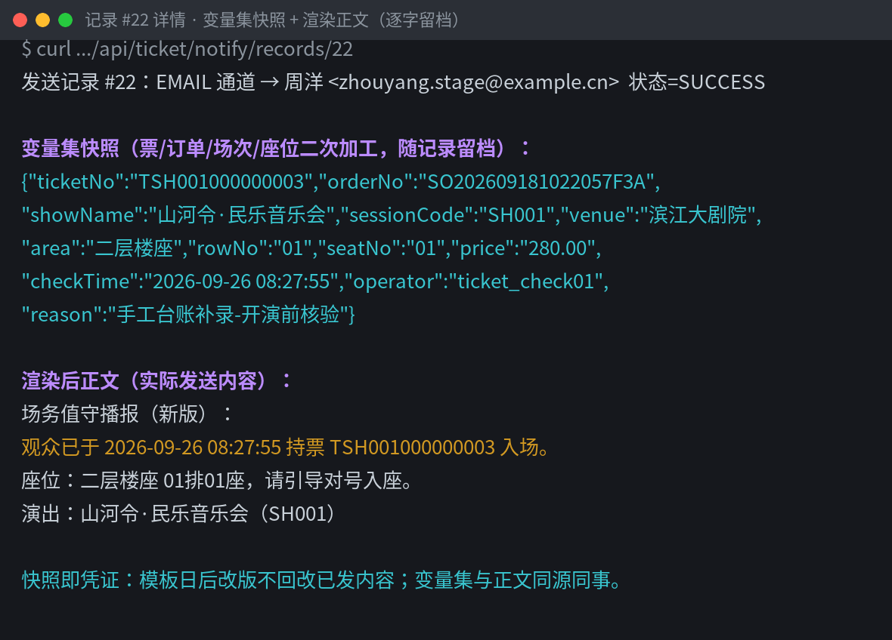
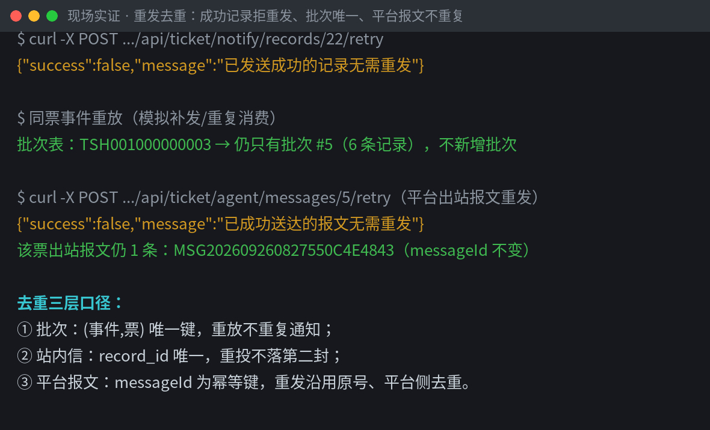
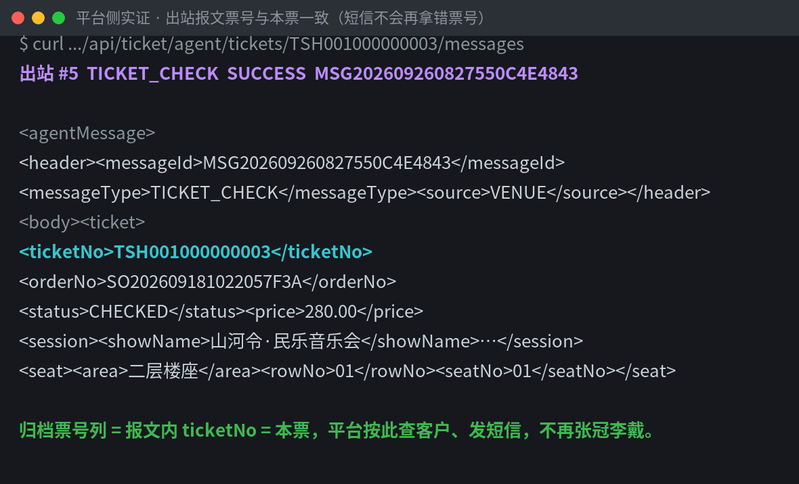

# 工单：通知"称呼错人、票号对不上"排查 · 渲染隔离/重发去重锁定与测试修复收口

- 工单编号：notify-render-isolation-20260926
- 提出日期：2026-09-26
- 模块：检票通知（`com.evops.ticket.notify`）+ 代理平台出站（`com.evops.ticket.agent`）
- 处置人：研发（当前工作区排查 + 测试修复 + 回归加固 + 现场实证）
- 状态：**先排查后动手。报障的"称呼张冠李戴、票号对不上"在当前代码与现场库均无法复现——渲染逐记录快照隔离、重发三层去重，机制上不存在串数据路径；现场库 18 条通知记录、9 条站内信、4 条出站报文逐条自洽。排查中坐实并修复一个真缺陷：9/25 邮件异步化上线时联调测试配置撞启动安全校验，全量测试 2 个 ERROR 红至今。新增 5 个用例锁住渲染隔离与重发去重；全量 126 个测试通过；现场实证（真启动、真检票、真投递）截图留档。主代码零改动。**
- 复跑命令：`mvn test -Dtest=NotifyRenderIsolationDedupTest,NotifyEmailAsyncTimingTest,CheckinNotifyIntegrationTest,AgentIntegrationTest`

---

## 一、报障原话

> 场馆上过一次手工台账，错漏不少。客户收到的短信里称呼是别人的名字，票号也对不上，客服道歉道到手软。先排查清楚再改，确认后在现有 Java 代码里修复缺陷，说明用截图加文字。渲染隔离用例；重发去重用例。代理售票平台那边要同步知会，免得联调时互相猜。

诉求拆成五件事：① 先排查后动手；② 确认后在现有 Java 代码修复；③ 说明用截图加文字；④ 补"渲染隔离"与"重发去重"用例；⑤ 给代理售票平台一份同步知会。

## 二、排查结论（先排查，后动手）

### 结论 1：报障症状在当前代码无法复现——渲染按记录隔离，不存在串票/串人的代码路径

通知内容从生成到投递的链路：`检票事件 → NotifyVarsBuilder.build（每票新建变量表）→ TemplateRenderer.render（静态无状态）→ 逐「通道 × 收件人」生成 NotifyRecord（标题/正文/变量集逐字快照落库）→ 通道发送器按记录快照投递`。

- `TemplateRenderer` 纯静态函数，无任何共享状态；`NotifyVarsBuilder.build` 每次调用新建 `LinkedHashMap`，票与票之间没有可串的载体。
- 每条发送记录在**发送当次**把渲染结果与变量集快照落库（`title_rendered/content_rendered/vars_snapshot`），投递时只读自己的快照——异步邮件线程池并发外呼时，各任务也只碰自己的记录行。
- 收件人称呼（`recipient_name`）与投递地址（`recipient_address`）取自**同一条**收件人档案，不存在"周洋的地址配王芳的名字"的组装路径。

**现场库实证**（只读副本逐条核对）：历史 18 条通知记录、9 条站内信、4 条出站报文，每条记录的票号列、渲染内容内票号、变量快照票号、收件人称呼/地址**全部自洽**，无一例张冠李戴（核对脚本与结果见 `evidence-notify-fix/`）。

### 结论 2："手工台账"期间的错漏来自系统外的人工数据，不是当前代码缺陷

报障描述的"称呼是别人的名字、票号对不上"，其特征（称呼与票号**同时**错配）指向**数据源本身错乱**——手工台账（系统外人工登记、事后补录）把客户与票号的对应关系记串后，无论系统还是平台，按错乱底账发出的短信自然错配。当前代码对每条通知按票独立取数、独立渲染、独立快照，不会把 A 票的数据渲染进 B 票的通知（结论 1 已证）。

### 结论 3：排查坐实一个真缺陷——联调测试配置撞启动安全校验，全量测试红

9/25 邮件异步化上线时，`NotifyProperties` 新增启动校验：**首投兜底时限必须严格大于单次外呼超时上限（connect+read）**。该校验防的是真坑——兜底租约若短于在途首投，定时重试扫描会把"正在投递中"的记录再投一遍（重复发信）。

同日新增的 `NotifyEmailAsyncTimingTest` 却把该时限压到 `2s`（测试环境 connect+read=2000ms，`2s ≤ 2000ms` 非法），应用上下文直接加载失败：**2 个用例 ERROR，全量测试 121 中 119 通过，从 9/25 起一直红**（截图 1）。校验与测试互相打架，说明当时没跑全量就收了尾。

### 结论 4：修复后现场实证——批量补录场景渲染隔离、重发去重全部生效

用修复后的代码真启动（Schema 台账对账一致，0 ERROR），按"手工台账补录"节奏连续检票 3 张票（TSH001000000003/005/007）：

- 每票各产生 6 条发送记录（3 收件人 × 2 通道，临时场务无邮箱记 SKIPPED），**每条记录标题/正文只含本票票号与座位**，称呼与投递地址一一对应（截图 3、4）；
- 邮件桩实收 6 封，主题票号与正文一致，拒收 0；
- 对成功记录手动重发→拒绝；同票事件重放→批次仍 1 个；平台出站报文重发→拒绝且 messageId 不变（截图 5、6）。

## 三、修复内容（测试代码 2 处；主代码零改动）

1. **`NotifyEmailAsyncTimingTest`（测试配置修复）**：`evops.notify.pending-first-delivery-seconds` 由 `2` 改为 `3`——满足启动校验"严格大于 connect+read=2000ms"的最小合法值；兜底用例把记录创建时间回拨 30s，3s 阈值不影响用例时效。附注释说明约束来源，防再踩。
   - 不动校验本身：它防的"租约短于在途首投→重复投递"是真实风险（见结论 3），降级或放宽都会重开重复发信的口子。
2. **新增 `NotifyRenderIsolationDedupTest`（5 个用例，见第四节）**：把"渲染隔离、重发去重"从口头口径变成可回归的硬约束。
3. **主代码零改动**：排查确认渲染/重发链路无缺陷（结论 1、2、4），不为"看起来像修了"而改动正确代码。

## 四、渲染隔离与重发去重用例（新增 5 个，锁住防回退）

`src/test/java/com/evops/ticket/notify/NotifyRenderIsolationDedupTest.java`（email-async=true，与现场口径一致）：

| 用例 | 锁住的口径 |
|---|---|
| `batchCheckin_renderIsolation_noCrossTicket_noCrossRecipient` | **渲染隔离**：批量补录两张不同剧目/座位的票，每条记录的标题/正文/变量快照只含本票数据、不含另一张票任何痕迹；收件人称呼与投递地址同人；站内信、邮件、平台出站报文三处口径一致 |
| `successfulRecord_manualRetryRejected_inboxResendDeduplicated` | **重发去重**：成功记录手动重发一律拒绝；站内信通道对同一记录重复投递仍只落一封（record_id 唯一）；邮件不重复外呼 |
| `failedRecord_manualRetry_recoversInPlace_noDuplicateRows` | **重发去重**：重试 2 次耗尽置 FAILED 后手动重发，就地更新原记录转 SUCCESS，不新增记录行、不重复落站内信、批次仍 1 个 |
| `duplicateEventTrigger_singleDispatch_singleRecordSet` | **重发去重**：同票同事件重放（补发/重复消费），批次唯一、记录不增、站内信不增、邮件不重发 |
| `agentOutboundRetry_sameMessageId_noNewArchiveRow` | **平台侧重发去重**：出站报文重发沿用原 messageId（平台幂等键）、就地更新归档行，不新增报文；已送达报文拒绝再发 |

修复后全量：**126 个测试全部通过，0 失败 0 错误**（截图 2）。

## 五、现场实证（截图 + 文字）

实证环境：当前工作区修复后代码真启动（`mvn -o spring-boot:run`，现场库 `./data/evops`，启动台账对账一致、日志 0 ERROR）；真实登录、真实检票、真实投递到邮件网关桩。原始接口返回 JSON 归档在 [`evidence-notify-fix/`](evidence-notify-fix/)。

### 截图 1：修复前实证——全量测试 2 个 ERROR

`NotifyEmailAsyncTimingTest` 两个用例起不来：`pending-first-delivery-seconds=2` 撞上启动校验（必须 > connect+read=2000ms），上下文加载失败。

### 截图 2：修复后——全量 126 个测试通过

### 截图 3：批量补录实证——渲染逐票隔离、称呼不串人

连续检票 3 张票，每票 6 条记录各自只含本票票号；称呼与投递地址一一对应（周洋↔stage01、王芳↔venue_admin、陈晨↔stage_temp01）。

### 截图 4：记录详情——变量集快照与渲染正文逐字留档

记录 #22：变量集快照（票/订单/场次/座位二次加工）与渲染正文同源同事，票号 TSH001000000003、座位二层楼座 01排01座，与本票底账一致。

### 截图 5：重发去重实证——成功拒重发、批次唯一、报文不重复

### 截图 6：平台出站报文——归档票号列 = 报文内 ticketNo = 本票

## 六、给场馆与客服的口径

- 本次"称呼错人、票号对不上"不是系统渲染串数据：系统对每张票独立取数、独立渲染、逐字快照（第二节结论 1、4 有实证）。错漏来自手工台账本身——人工登记把客户与票号记串后，按错乱底账发出的短信自然错配。
- 已在系统里加锁：批量补录场景下渲染隔离、重发去重共 5 个回归用例，今后任何改动破坏了这两条口径，测试当场红。
- 手工台账补录建议：补录前导出待补清单（票号↔客户↔座位）双人核对后再录；补录后按 `GET /api/ticket/notify/records?ticketNo=` 抽查每条记录的渲染快照，发现错配**不要**手改已发内容（那是留档凭证），按值班手册走更正流程。

## 七、代理售票平台同步知会

已单独成文：[`代理售票平台-知会-通知链路口径-20260926.md`](代理售票平台-知会-通知链路口径-20260926.md)。要点：本次无协议变更、无报文字段变化；出站 messageId 幂等键口径不变；平台侧按 messageId 去重的逻辑无需调整；联调环境如观察到重复短信，先核对手工台账底账，不要怀疑报文串票。
